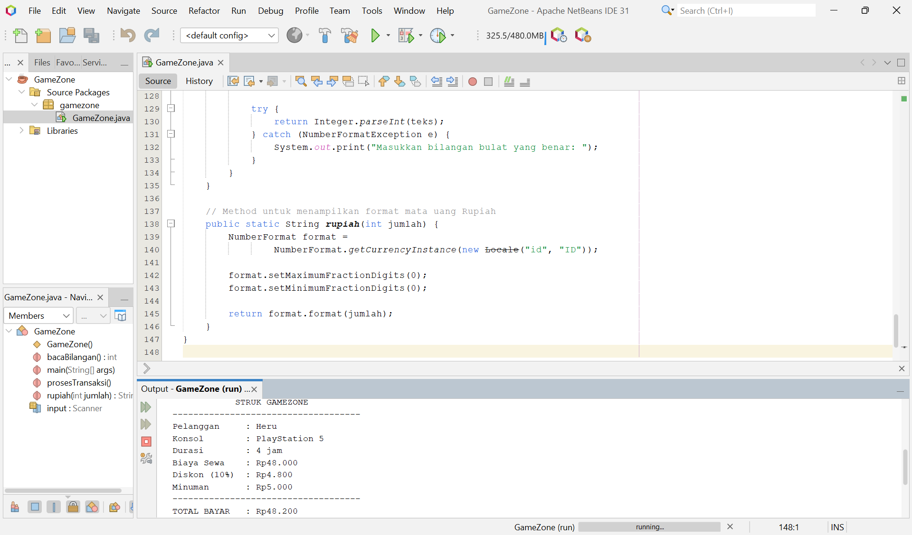

# GameZone Rental PS

**Nama:** Heru Rujhanul M.  
**NIM:** C2483207014  
**Program Studi:** Pendidikan Teknologi Informasi  
**Universitas:** Universitas Muhammadiyah Tasikmalaya

## Deskripsi Proyek

GameZone Rental PS adalah aplikasi berbasis console yang dibuat menggunakan bahasa pemrograman Java. Program ini membantu petugas menghitung biaya penyewaan PlayStation 4 dan PlayStation 5 serta menampilkan struk pembayaran pelanggan.

## Fitur Program

- Memasukkan nama pelanggan.
- Memilih PlayStation 4 atau PlayStation 5.
- Menghitung biaya sewa berdasarkan durasi bermain.
- Memberikan diskon 10% untuk penyewaan minimal 3 jam.
- Menambahkan minuman seharga Rp5.000 secara opsional.
- Menampilkan struk dan total pembayaran.
- Melayani transaksi baru tanpa menjalankan ulang program.

## Teknologi yang Digunakan

- Bahasa pemrograman Java.
- Apache NetBeans IDE.
- Scanner untuk input.
- Percabangan if-else.
- Perulangan while.
- Method buatan sendiri.

## Cara Menjalankan Program

1. Buka Apache NetBeans IDE.
2. Pilih File > Open Project.
3. Pilih folder proyek GameZone.
4. Buka Source Packages dan class GameZone.java.
5. Jalankan program menggunakan Run File.
6. Masukkan data pelanggan sesuai petunjuk program.

## Rumus Perhitungan

Biaya sewa = Harga sewa per jam × Durasi bermain.

Diskon = 10% dari biaya sewa jika durasi minimal 3 jam.

Total pembayaran = Biaya sewa − Diskon + Biaya minuman.

## Screenshot Hasil Program

## Penutup

Program ini dibuat untuk memenuhi latihan praktikum Pemrograman Java Dasar dengan studi kasus sistem rental PlayStation GameZone.

